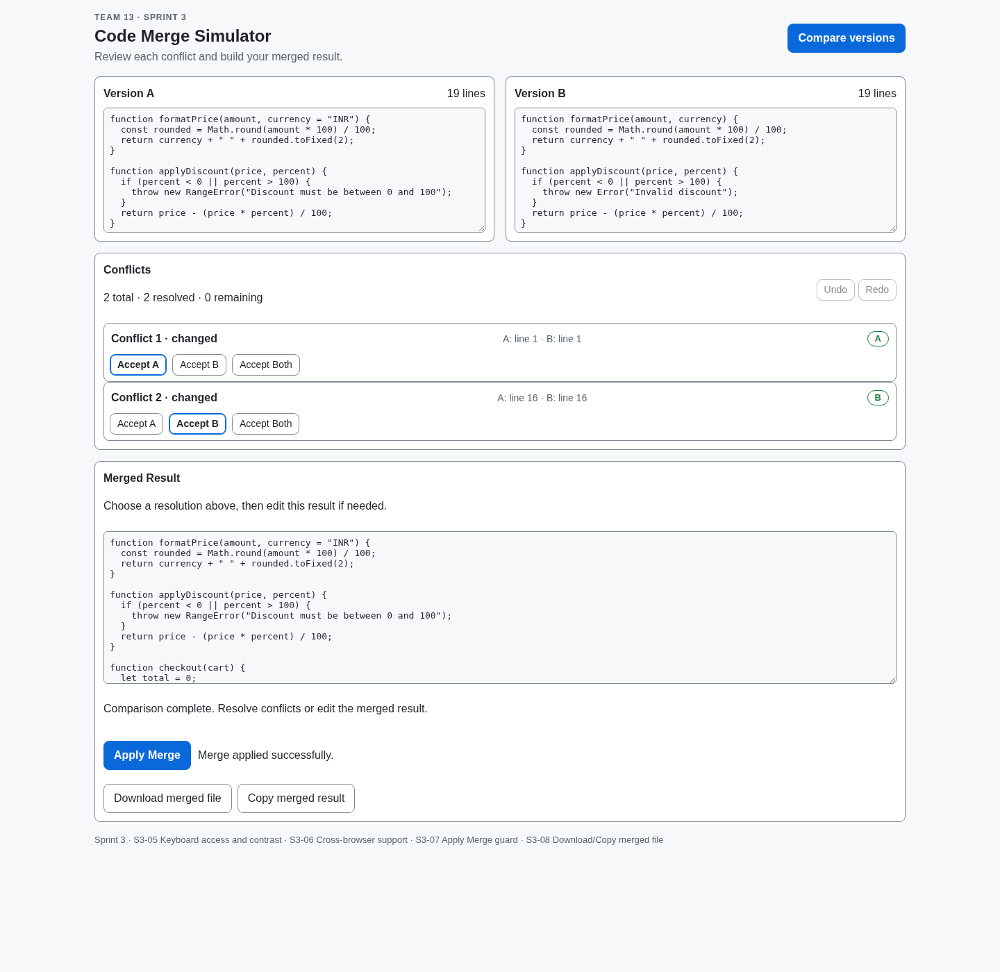
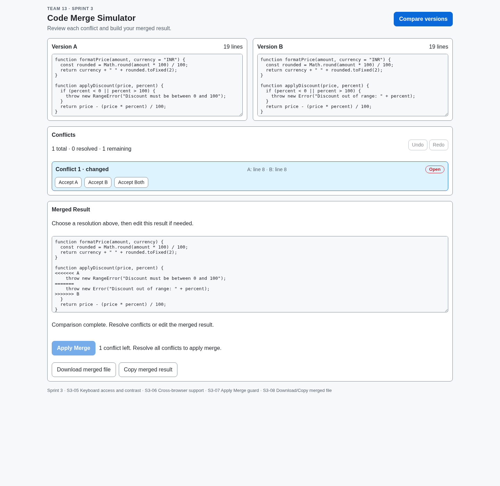
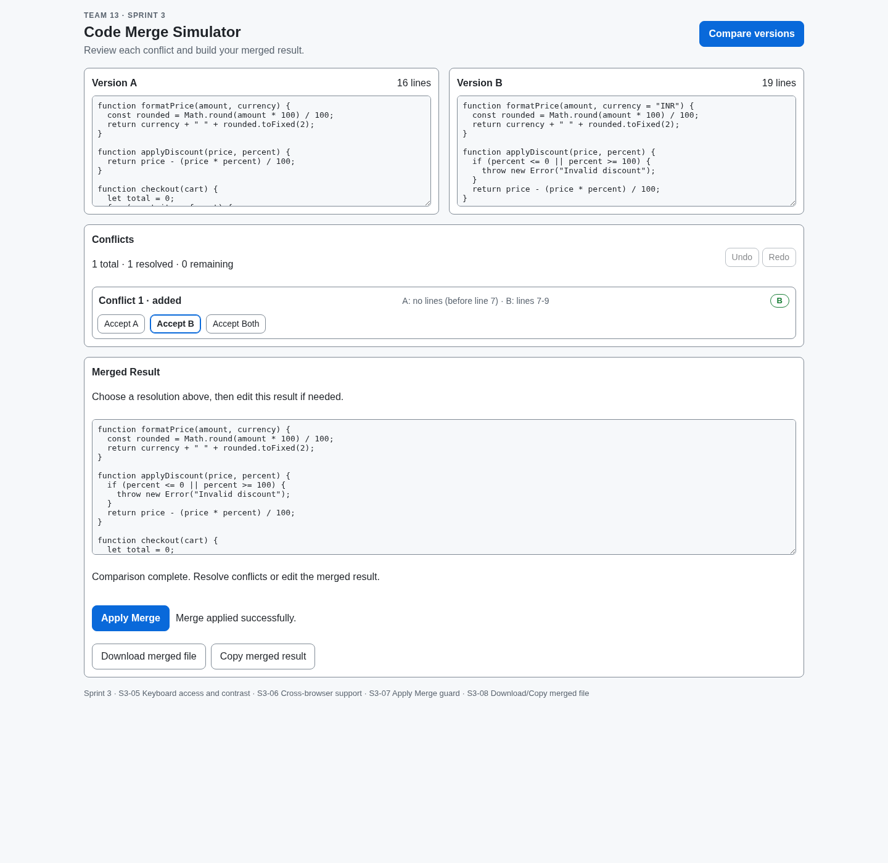

# S3-10 — Demo script, screenshots and live demo

**Project:** Team 13 — Code Merge Simulator  
**Target audience:** evaluator, faculty and project reviewers  
**Suggested duration:** 5–7 minutes  
**Live URL after GitHub Pages is enabled:** `https://kishanks43.github.io/Team-13/`

> The URL above is the expected GitHub Pages URL for this public repository. It is not a claim that deployment has already happened. The repository owner must enable Pages with **GitHub Actions** as the source and merge/push this workflow before the live link can be verified.

## 1. Before the presentation

1. Open the live URL in a current browser, or run the local fallback below.
2. For a guided live demonstration with each sample preloaded, open the matching helper URL in section 3. The helper embeds the actual application and prepares the specified state.
3. Confirm both input editors, the conflict list, merged result and export controls are visible.
4. Use a fresh page load before each scenario so the conflict/resolution state starts clean.

### Local fallback

```bash
npm ci
npm start
```

Open `http://localhost:8080`.

## 2. Presentation script

### Opening — 30 seconds

**Say:** “Our project is a browser-based Code Merge Simulator. It compares two versions of a source file, groups changed regions into conflicts, and lets a reviewer resolve each conflict before applying or exporting the merged result.”

**Show:** the two input panes, Compare button, conflict area, Merged Result editor and Apply/Download/Copy controls.

### Scenario 1 — Separate edits — 2 minutes

**Purpose:** demonstrate that independent edits are detected as two separate conflicts and can be resolved individually.

1. Open the `separate-edits` guided demo URL in section 3, or paste the sample values from `src/samples.js` into Version A and Version B and select **Compare versions**.
2. Point out the two conflicts and the total/resolved/remaining counter.
3. In a fresh manual run, select **Accept A** for Conflict 1 and **Accept B** for Conflict 2.
4. Show that both statuses update and the remaining count reaches zero.
5. Select **Apply Merge**. Point out that the button is disabled while conflicts are open and becomes enabled after all conflicts are resolved.
6. Optionally select **Download merged file** and confirm the downloaded filename is `merged-result.txt`.

**Say:** “The app preserves unchanged lines and lets us choose a different resolution for each changed region. Apply Merge is gated until the conflict list is fully resolved.”

### Scenario 2 — Same-line conflict — 1–2 minutes

**Purpose:** demonstrate a genuine competing edit to the same code line and Git-style conflict markers.

1. Start with a fresh page and open the `same-line-conflict` guided demo URL in section 3, or load that sample manually from `src/samples.js`.
2. Show the single open conflict and the `<<<<<<< A`, `=======` and `>>>>>>> B` markers in Merged Result.
3. Resolve it using **Accept Both** (or choose A/B and explain the trade-off).
4. Show that the marker block disappears and Apply Merge becomes enabled.

**Say:** “When a conflict is unresolved, the merged pane makes the competing versions explicit with familiar Git-style markers. Resolving the conflict removes the marker block.”

### Scenario 3 — Deleted versus modified — 1–2 minutes

**Purpose:** demonstrate a deletion-versus-edit case.

1. Start with a fresh page and open the `deleted-vs-modified` guided demo URL in section 3, or load that sample manually from `src/samples.js`.
2. Explain that one version removed the validation block while the other changed it.
3. In a fresh manual run, choose **Accept B** to keep the modified validation block.
4. Show the final merged result and enabled Apply Merge button.

**Say:** “The tool also exposes cases where one side removes code and the other side edits it. The reviewer makes the final decision rather than having the tool silently choose.”

### Closing — 30 seconds

**Say:** “The finished workflow covers comparison, conflict grouping, per-conflict resolution, manual editing, merge guarding and export. The project also includes automated tests and keyboard/accessibility and cross-browser checks.”

Do not claim that a browser audit or four-browser manual test has passed unless the team has completed and recorded those checks separately.

## 3. Screenshot guide

The screenshots in `docs/demo/screenshots/` were captured from the actual page using the included screenshot-preparation helper:

- `01-separate-edits.png` — two conflicts resolved independently.
- `02-same-line-open-markers.png` — unresolved same-line conflict with Git-style markers.
- `03-deleted-vs-modified.png` — deletion-versus-modification conflict resolved by choosing B.







To regenerate the screenshots, serve the repository root and open the helper with the scenario query string:

```bash
npm start
```

```text
http://localhost:8080/docs/demo/prepare-screenshots.html?scenario=separate-edits
http://localhost:8080/docs/demo/prepare-screenshots.html?scenario=same-line-conflict
http://localhost:8080/docs/demo/prepare-screenshots.html?scenario=deleted-vs-modified
```

Use a 1440px-wide browser window. The helper prepares the sample automatically; you can interact with the real app inside the frame. The PNGs checked into this story are static presentation captures, while the helper URLs provide the live interaction.

## 4. GitHub Pages deployment

The workflow `.github/workflows/deploy.yml` publishes the repository root as a static GitHub Pages site after a push to `main` (and can be run manually).

Repository owner setup:

1. Open **Settings → Pages** in `Kishanks43/Team-13`.
2. Under **Build and deployment → Source**, choose **GitHub Actions**.
3. Merge this story's pull request into `main`.
4. Open **Actions → Deploy to GitHub Pages** and wait for the deployment job to succeed.
5. Verify `https://kishanks43.github.io/Team-13/` in a private/incognito window and update this document with the verified URL/date if GitHub Pages displays a different URL.

The workflow cannot enable the repository Pages setting by itself. The repository owner must perform step 2.

## 5. Presenter checklist

- [ ] Live page opens over HTTPS.
- [ ] Scenario 1 shows two conflicts and both can be resolved.
- [ ] Apply Merge stays disabled while conflicts remain.
- [ ] Scenario 2 shows Git-style markers while open and removes them after resolution.
- [ ] Scenario 3 demonstrates deleted-versus-modified handling.
- [ ] Download produces the merged text file.
- [ ] No test, browser or accessibility claim is made without a recorded passing result.
